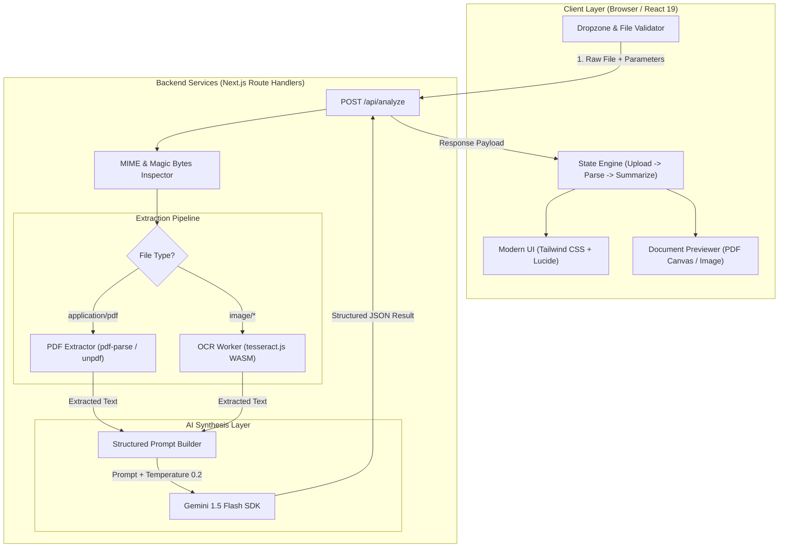
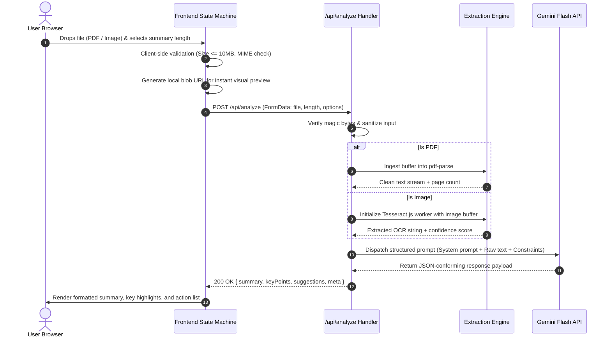

# Technical Architecture Document (TAD)
## Document Summary Assistant ("DocBrief")

**Document Version:** 1.0.0  
**Architect:** Full-Stack Engineering Candidate  
**Target Platform:** Next.js (App Router) on Vercel Serverless  

---

## 1. System Overview

**DocBrief** is built as a unified, full-stack TypeScript application utilizing the Next.js App Router architecture. It combines client-side drag-and-drop ingestion and real-time previews with serverless API route handlers for document parsing, optical character recognition (OCR), and generative AI synthesis.



---

## 2. Technology Stack & Decision Rationale

| Layer | Chosen Technology | Alternatives Evaluated | Rationale for Decision |
| :--- | :--- | :--- | :--- |
| **Framework** | **Next.js 14/15 (App Router, TypeScript)** | Vite + React + Express; FastAPI + Vue | Single-repository simplicity, integrated API route handlers, zero-config deployment to Vercel, end-to-end type safety. |
| **UI & Styling** | **Tailwind CSS + Lucide Icons + Radix UI** | Material UI, Bootstrap, Ant Design | Zero runtime CSS overhead, accessible primitive components, mobile-responsive grid, rapid UI iteration within 8 hours. |
| **PDF Extraction** | **`pdf-parse` / `unpdf`** | `pdfplumber` (Python), `pdf2json` | Pure JavaScript/Node execution without external native OS bindings; operates smoothly inside serverless execution limits. |
| **OCR Engine** | **`tesseract.js` (WebAssembly)** | Google Cloud Vision API, AWS Textract, native C++ Tesseract | Zero external cloud billing dependency for basic OCR; eliminates system-level C++ binary dependencies required by native Tesseract. |
| **LLM Provider** | **Google Gemini 1.5 Flash (`@google/genai`)** | OpenAI GPT-4o-mini, Anthropic Claude 3 Haiku | Sub-second latency, generous free-tier rate limits (15 RPM / 1M tokens/min), massive context window (1M tokens), and cost-effectiveness. |
| **Deployment** | **Vercel Serverless Platform** | AWS ECS, DigitalOcean, Heroku | Native git-based CI/CD, automatic preview deployments, zero infrastructure maintenance, built-in edge caching and TLS. |

---

## 3. Data Flow & Processing Pipeline

The document ingestion lifecycle moves through four deterministic stages:



---

## 4. API Specification & Interface Contracts

### 4.1. Endpoint: Analyze Document
- **Route:** `POST /api/analyze`
- **Content-Type:** `multipart/form-data`

#### Request Payload
| Field | Type | Required | Description |
| :--- | :--- | :--- | :--- |
| `file` | `File (Binary)` | Yes | PDF or image file (`.pdf`, `.png`, `.jpg`, `.jpeg`, `.webp`). Max 10MB. |
| `length` | `string` | No | `'short'` \| `'medium'` \| `'long'` (Default: `'medium'`). |
| `includeSuggestions` | `boolean` | No | Whether to compute improvement suggestions (Default: `true`). |

#### Response Payload (`200 OK`)
```json
{
  "success": true,
  "data": {
    "summary": "This document outlines the quarterly financial results of Acme Corp...",
    "length": "medium",
    "keyPoints": [
      "Revenue grew by 24% year-over-year reaching $12.4M.",
      "Customer acquisition cost dropped by 14% due to organic search channels.",
      "Operating margin expanded to 18.2% from 15.1% in Q2.",
      "New enterprise SaaS product launch scheduled for Q4."
    ],
    "improvementSuggestions": [
      {
        "category": "Data Completeness",
        "priority": "high",
        "suggestion": "Include churn rate metrics alongside net ARR expansion for a complete retention picture."
      },
      {
        "category": "Readability",
        "priority": "medium",
        "suggestion": "Replace repetitive acronyms in Section 3 with a dedicated glossary table."
      }
    ],
    "meta": {
      "fileName": "Q3_Financial_Review.pdf",
      "fileType": "application/pdf",
      "fileSizeKb": 1420,
      "pageCount": 4,
      "wordCount": 1845,
      "extractedCharacters": 11200,
      "processingTimeMs": 3420,
      "modelUsed": "gemini-1.5-flash"
    }
  }
}
```

#### Error Response Payload (`4xx / 5xx`)
```json
{
  "success": false,
  "error": {
    "code": "UNSUPPORTED_FILE_TYPE",
    "message": "The provided file format (.bmp) is not supported. Please upload a PDF or PNG/JPG image.",
    "details": null
  }
}
```

---

## 5. AI Prompt Engineering Strategy

To guarantee deterministic, hallucination-resistant outputs, the backend enforces JSON Schema structured outputs via Gemini system instructions:

### System Prompt Structure
```text
You are an expert document analyst and executive communication specialist.
Analyze the following extracted document text thoroughly and objectively.

Follow these strict constraints:
1. SUMMARY LENGTH:
   - "short": Approximately 80-120 words. Executive summary capturing the core premise and resolution.
   - "medium": Approximately 200-300 words. Comprehensive overview balancing context, methodology, and results.
   - "long": Approximately 450-650 words. Detailed section-by-section breakdown with operational implications.
2. KEY POINTS:
   - Extract 4 to 6 concise, bulleted key takeaways capturing numbers, facts, and pivotal statements.
3. IMPROVEMENT SUGGESTIONS:
   - Identify 2 to 4 actionable suggestions to enhance clarity, eliminate ambiguity, or address missing information.
   - Assign a priority ('high', 'medium', 'low') and category to each suggestion.
4. TONE:
   - Professional, neutral, concise. Do not use pleasantries or mention that you are an AI assistant.
5. FORMAT:
   - Return strictly valid JSON conforming to the requested schema.
```

---

## 6. Failure Recovery & Edge Case Architecture

| Scenario | System Defense / Mitigation |
| :--- | :--- |
| **Corrupted / Encrypted PDF** | `pdf-parse` throws an error; API catches and returns `422 Unprocessable Entity` with message: *"Document is password-protected or corrupted."* |
| **Scanned Blank Image** | OCR returns `< 20` characters; API immediately halts without calling LLM, returning: *"Insufficient legible text detected in image. Please provide a higher-resolution scan."* |
| **Exceeding LLM Token Limit** | Text chunking & truncation guardrail: If extracted text > 400,000 characters, smart windowing retains introduction, section headers, and conclusions. |
| **LLM Rate Limit (429)** | Exponential backoff retry handler with jitter (up to 2 retries) before responding with a graceful retry suggestion toast. |
| **Large File Upload Timeout** | Next.js serverless payload body parser configured up to 10MB; client displays real-time progress bar. |
