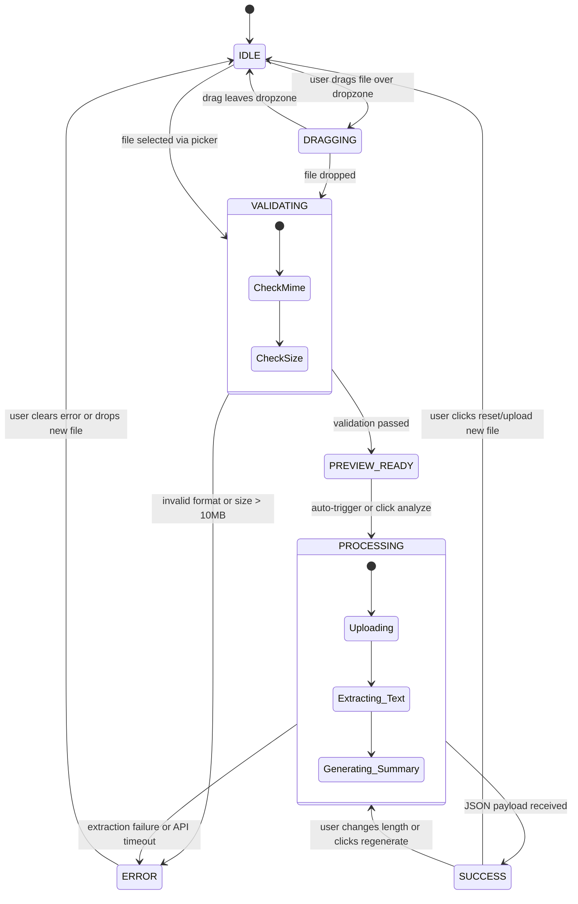

# Frontend Specification Document
## Document Summary Assistant ("DocBrief")

**Document Version:** 1.0.0  
**Design Lead:** Frontend / UI Engineering Specialist  
**Design System Base:** Tailwind CSS + Radix UI + Lucide Icons  

---

## 1. Design Philosophy & Visual Language

DocBrief adopts a **clean, modern executive productivity aesthetic** (inspired by Linear, Vercel, and Notion). The interface prioritizes high information density without clutter, frictionless drag-and-drop workflows, and immediate visual feedback across all processing stages.

### 1.1. Color System
- **Neutral Background:** Slate-950 (Dark mode canvas) / Gray-50 (Light mode canvas)
- **Surfaces & Cards:** Slate-900 / Slate-800 borders (Dark) / White / Gray-200 (Light)
- **Primary Accent:** Indigo-600 (`#4f46e5`) & Violet-500 (`#8b5cf6`) gradient for primary call-to-actions and active states.
- **Semantic Accents:**
  - Success / Complete: Emerald-500 (`#10b981`)
  - High Priority / Warning: Amber-500 (`#f59e0b`) / Rose-500 (`#f43f5e`)
  - Info / Medium Priority: Sky-500 (`#0284c7`)
  - Low Priority: Slate-400 (`#94a3b8`)

### 1.2. Typography
- **Font Family:** Inter / system font stack (`ui-sans-serif, system-ui, -apple-system, sans-serif`).
- **Hierarchy:**
  - Hero Header: 24px - 30px, Font Weight 700.
  - Section Headings: 16px - 18px, Font Weight 600, uppercase letter-spacing tracking.
  - Body Text: 14px - 15px, Line Height 1.6 for enhanced reading comfort.
  - Metadata & Badges: 12px, Font Weight 500, tabular figures.

---

## 2. Layout & Screen Architecture

### 2.1. Dual-Column Desktop Workspace (>= 1024px)
On desktop screens, the interface is split into a **50/50 dual-column workspace** that allows simultaneous side-by-side inspection:

```
+-----------------------------------------------------------------------------------+
|  [Logo] DocBrief              Multi-Format Document Synthesizer    [GitHub] [Theme]|
+-----------------------------------------------------------------------------------+
|                                                                                   |
|  LEFT PANEL: Input & Document Preview      | RIGHT PANEL: Synthesis & Intelligence|
|  ----------------------------------------  | ------------------------------------ |
|  [ Drag & Drop Zone / File Picker ]        |  Summary Length: [Short] [Med] [Long]|
|  - Supports PDF & Images (PNG/JPG)        |                                      |
|  - Instant validation & size check        |  [ Progressive Multi-Stage Status ]  |
|                                            |                                      |
|  [ Document Preview Canvas ]               |  [ Executive Summary Section ]       |
|  - PDF page rendering or image viewport    |  - Rich markdown, reading time, word |
|  - Zoom controls / Page switcher          |    count metrics                     |
|  - [View Extracted Raw Text] toggle        |                                      |
|                                            |  [ Key Highlights (Bulleted Cards) ] |
|                                            |                                      |
|                                            |  [ Document Improvement Suggestions] |
|                                            |  - Priority Badges (High/Med/Low)    |
|                                            |                                      |
|                                            |  [ Action Bar: Copy | Export | Reset]|
+-----------------------------------------------------------------------------------+
```

### 2.2. Mobile & Tablet Responsive Architecture (< 1024px)
- Single-column stacked layout with a sticky segmented view switcher at the top:
  `[ Document Preview ]` | `[ AI Summary & Insights ]`
- Floating Action Button (FAB) or bottom docked action bar for quick copy and re-summarization.

---

## 3. Component Hierarchy & Specifications

```
src/
└── components/
    ├── Header.tsx              // Branding, documentation links, theme toggle
    ├── Dropzone.tsx            // File upload zone with drag events & format badges
    ├── FileInfoBar.tsx         // File metadata (name, size, format, remove button)
    ├── DocumentViewer.tsx      // Side-by-side viewer (PDF canvas / Image view)
    ├── ExtractedTextModal.tsx  // Drawer/modal to review raw OCR/PDF extracted text
    ├── SummaryControls.tsx     // Length selector (Short/Medium/Long), Re-run button
    ├── ProcessingStepper.tsx   // Animated stage progression indicator
    ├── SummaryCard.tsx         // Markdown summary renderer with typography styling
    ├── KeyPointsList.tsx       // Key highlights list with visual bullet accents
    ├── SuggestionsList.tsx     // Ranked improvement recommendations with priority tags
    └── ActionBar.tsx           // One-click Copy, Export (.md/.txt), and Reset buttons
```

### 3.1. Dropzone Component (`Dropzone.tsx`)
- **Idle State:** Displays cloud upload icon, *"Drop your PDF or image here, or browse"*, format badges (`PDF`, `PNG`, `JPG`, `WEBP`), and 10MB limit notice.
- **Drag-Over State:** Dashed border switches to glowing indigo ring; background pulses subtly; text updates to *"Release file to upload"*.
- **Validation:** Immediate client-side validation of file extension, MIME type, and byte size. Rejects invalid files with an animated toast warning.

### 3.2. Processing Stepper (`ProcessingStepper.tsx`)
Visual indicator rendering active processing state with animated pulse:
1. `Step 1: Uploading & Validating` (File verification)
2. `Step 2: Extracting Text & OCR` (Parsing PDF streams or running Tesseract OCR worker)
3. `Step 3: AI Synthesis` (Invoking Gemini Flash model with length parameters)

### 3.3. Document Viewer (`DocumentViewer.tsx`)
- If file is an image: Renders responsive `` with lightbox zoom and pan capability.
- If file is a PDF: Renders an embedded `<iframe />` or canvas renderer with page scroll.
- Includes a secondary toggle button: *"View Extracted Raw Text"*, opening an inspect modal.

### 3.4. Summary & Insights Displays
- **Summary Length Selector:** 3-segmented button group (`Short (~100w)`, `Medium (~250w)`, `Long (~500w)`). Selecting a new length triggers background re-summarization from cached extracted text without needing to re-upload.
- **Copy Action:** Changes icon from `Copy` to `Check` with green flash for 2000ms upon successful clipboard write.
- **Export Action:** Generates a downloadable `.txt` or `.md` file containing the document summary, key takeaways, and improvement suggestions with clean metadata headers.

---

## 4. Frontend State Machine



---

## 5. Accessibility (a11y) & User Delight

1. **Keyboard Accessibility:**
   - Dropzone is focusable via `Tab` key and triggers file dialog on `Enter` or `Space`.
   - All interactive badges and buttons feature visible focus rings (`focus-visible:ring-2 focus-visible:ring-indigo-500`).
2. **Screen Reader Support:**
   - ARIA live regions (`aria-live="polite"`) announce processing state updates (*"Extracting text..."*, *"Summary completed"*).
   - High priority improvement suggestions have `role="alert"` or explicit priority labels.
3. **Empty & Loading States:**
   - Skeleton screen placeholders mimic paragraph lines and bullet cards during generation to eliminate layout shifts (CLS = 0).
